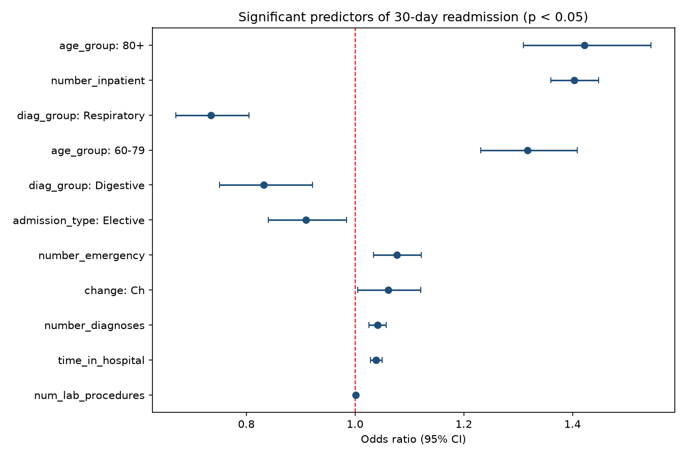
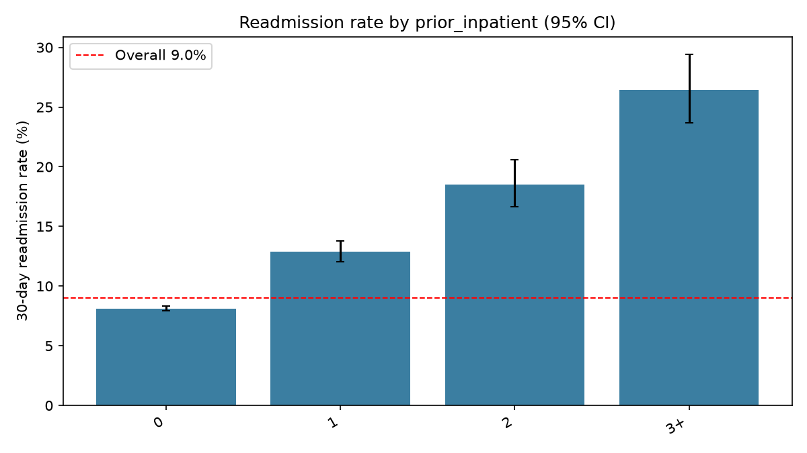

# Hospital Readmission Analysis: Patients with Diabetes

Analysis of which patient and clinical factors are associated with 30-day hospital readmission, using data from 130 US hospitals (1999-2008).

**Tools:** Python (pandas, NumPy, SciPy, Matplotlib), SQL (SQLite)

## Business Problem

Readmissions within 30 days of discharge are costly and a common hospital quality measure. This project identifies which patient groups are at higher risk, so follow-up care can be targeted where it matters most.

## Dataset

- **Diabetes 130-US Hospitals for Years 1999-2008**, UCI Machine Learning Repository
- 101,766 hospital encounters, de-identified, license CC BY 4.0
- Link: https://archive.ics.uci.edu/dataset/296/diabetes-130-us-hospitals-for-years-1999-2008
- Paper: Strack et al. (2014), https://doi.org/10.1155/2014/781670
- Citation: Clore, J., Cios, K., DeShazo, J., & Strack, B. (2014). Diabetes 130-US Hospitals for Years 1999-2008 [Dataset]. UCI Machine Learning Repository. https://doi.org/10.24432/C5230J

## Methods

1. Removed patients who died or went to hospice (they cannot be readmitted)
2. Removed records with invalid gender
3. Kept the first encounter per patient to avoid repeated-visit bias (101,766 encounters became 69,987 patients)
4. Grouped ages and ICD-9 diagnosis codes into broader categories
5. Treated "HbA1c not tested" as its own category
6. Rates with 95% confidence intervals, chi-square tests, and multivariable logistic regression (odds ratios)
7. Seven SQL queries (CASE, HAVING, CTE, window function) in `sql/queries.sql`

## Key Results

- **Patients analysed:** 69,987
- **Overall 30-day readmission rate:** 8.98%
- **Average length of stay:** 4.27 days

**Readmission rate by number of prior inpatient visits (previous year)**

| Prior inpatient visits | Patients | Readmission rate | 95% CI |
|---|---|---|---|
| 0 | 61,792 | 8.13% | 7.92 - 8.35 |
| 1 | 5,798 | 12.88% | 12.05 - 13.77 |
| 2 | 1,501 | 18.52% | 16.64 - 20.57 |
| 3 or more | 896 | 26.45% | 23.67 - 29.44 |

**Strongest independent predictors (logistic regression, adjusted for all other factors)**

| Factor | Odds ratio | 95% CI |
|---|---|---|
| Age 80+ (vs 40-59) | 1.42 | 1.31 - 1.54 |
| Each additional prior inpatient visit | 1.40 | 1.36 - 1.45 |
| Age 60-79 (vs 40-59) | 1.32 | 1.23 - 1.41 |
| Each additional prior emergency visit | 1.08 | 1.03 - 1.12 |
| Diabetes medication changed during stay | 1.06 | 1.00 - 1.12 |
| Respiratory primary diagnosis (vs circulatory) | 0.73 | 0.67 - 0.80 |
| Digestive primary diagnosis (vs circulatory) | 0.83 | 0.75 - 0.92 |
| Elective admission (vs emergency) | 0.91 | 0.84 - 0.98 |

**Other findings**

- Number of prior inpatient visits was the clearest signal of readmission risk: patients with 3 or more had about three times the rate of patients with none.
- Age was strongly associated with readmission (chi-square p < 0.001); patients over 60 had higher odds than those aged 40-59.
- HbA1c testing was **not** significantly associated with 30-day readmission (chi-square p = 0.061; adjusted odds ratios 0.90-0.92 with confidence intervals including 1).
- Gender showed no significant difference (p = 0.59).

## Recommendations

1. Prioritise post-discharge follow-up (calls, early clinic visits) for patients with two or more inpatient stays in the past year; this group had readmission rates of 18-26%.
2. Include age (especially 80+) as a risk flag in discharge planning.
3. Use prior inpatient and emergency visit counts as simple, low-cost screening variables to identify high-risk patients.
4. Do not rely on HbA1c testing alone as a readmission lever, since no significant association was found in this data.

## How to Run

    pip install -r requirements.txt
    python -m src.analysis
    python -m src.sql_demo

## Limitations

- Data is from 1999-2008 and uses ICD-9 coding, so practices have since changed
- Results show association, not causation
- Only the first encounter per patient is analysed
- A few very small groups (for example "Trauma center" admissions and "Unknown" diagnosis) produced unstable estimates and were not interpreted
- For education and portfolio use only, not for clinical decisions

## License

MIT